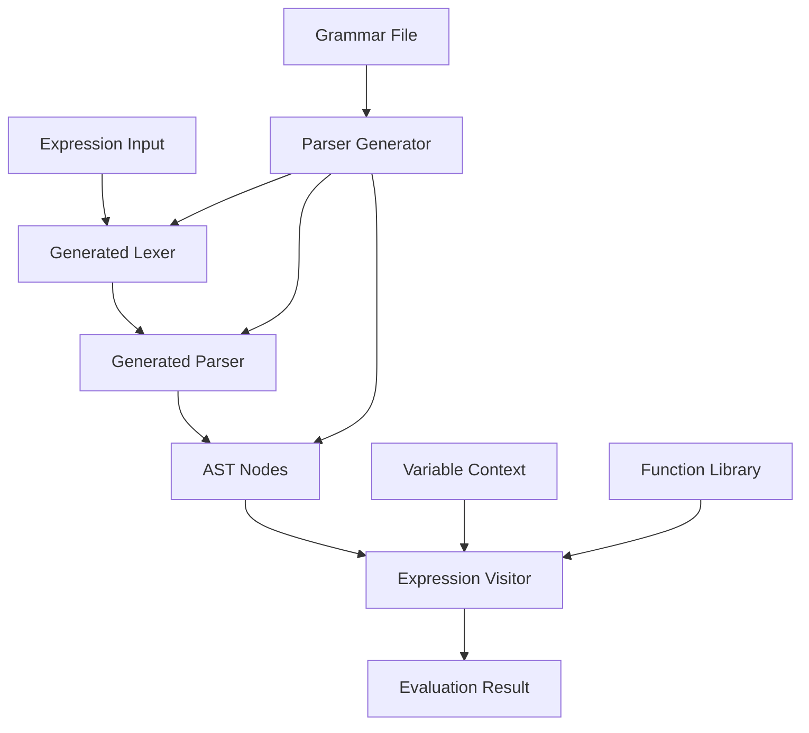

# Design Document

## Overview

The Expression Evaluator Demo is a Maven-based demonstration project that showcases the yacc-like-parser-generator tool by creating a complete mathematical expression evaluator. The project follows a clean architecture with separation between parsing, AST representation, and evaluation logic using the visitor pattern.

The system processes the expression-evaluator.grammar file to generate parser components, then implements a visitor-based evaluator that can handle complex mathematical expressions including functions, constants, and proper operator precedence.

## Architecture

The system follows a layered architecture with clear separation of concerns:



### Core Layers

1. **Generated Parser Layer**: Auto-generated lexer, parser, and AST classes
2. **Evaluation Layer**: Visitor pattern implementation for expression evaluation
3. **Context Layer**: Variable storage and function library management
4. **Application Layer**: Main application and CLI interface

## Components and Interfaces

### Generated Components (Auto-generated by yacc-like-parser-generator)

#### ExpressionLexer
- **Responsibility**: Tokenizes mathematical expression input
- **Generated From**: Terminal definitions in expression-evaluator.grammar
- **Key Methods**:
  - `nextToken()`: Returns next token from input stream
  - `hasMoreTokens()`: Checks if more tokens are available

#### ExpressionParser
- **Responsibility**: Parses tokenized input into AST
- **Generated From**: Production rules in expression-evaluator.grammar
- **Key Methods**:
  - `parse()`: Main parsing entry point returning root AST node
  - `parseExpression()`: Parses expression with proper precedence

#### AST Node Classes
Generated classes for each non-terminal in the grammar:
- **ExpressionNode**: Base class for all expression nodes
- **BinaryOpNode**: Represents binary operations (+, -, *, /, %, ^)
- **UnaryOpNode**: Represents unary operations (unary minus)
- **FunctionCallNode**: Represents function calls (sin, cos, log, etc.)
- **NumberNode**: Represents numeric literals
- **IdentifierNode**: Represents variables and constants
- **ParenthesesNode**: Represents parenthesized expressions

### Custom Implementation Components

#### ExpressionEvaluator
- **Responsibility**: Main evaluator using visitor pattern
- **Interface**: `double evaluate(ExpressionNode node, VariableContext context)`
- **Key Methods**:
  - `visitBinaryOp(BinaryOpNode node)`: Evaluates binary operations
  - `visitUnaryOp(UnaryOpNode node)`: Evaluates unary operations
  - `visitFunctionCall(FunctionCallNode node)`: Evaluates function calls
  - `visitNumber(NumberNode node)`: Returns numeric value
  - `visitIdentifier(IdentifierNode node)`: Resolves variables/constants

#### VariableContext
- **Responsibility**: Manages variable storage and lookup
- **Interface**: Variable storage and retrieval
- **Key Methods**:
  - `setVariable(String name, double value)`: Stores variable value
  - `getVariable(String name)`: Retrieves variable value
  - `hasVariable(String name)`: Checks if variable exists
  - `getConstants()`: Returns built-in constants (pi, e)

#### MathFunctionLibrary
- **Responsibility**: Provides mathematical function implementations
- **Interface**: Function evaluation utilities
- **Key Methods**:
  - `sin(double x)`: Trigonometric sine
  - `cos(double x)`: Trigonometric cosine
  - `tan(double x)`: Trigonometric tangent
  - `log(double x)`: Natural logarithm
  - `log(double base, double x)`: Logarithm with custom base
  - `sqrt(double x)`: Square root
  - `abs(double x)`: Absolute value

#### ExpressionCalculator
- **Responsibility**: Main application class coordinating all components
- **Interface**: High-level expression evaluation API
- **Key Methods**:
  - `evaluate(String expression)`: Evaluates expression string
  - `evaluateWithVariables(String expression, Map<String, Double> variables)`: Evaluates with variable context
  - `parseOnly(String expression)`: Parses without evaluation for debugging

### Support Components

#### ExpressionException
- **Responsibility**: Custom exception for expression evaluation errors
- **Types**:
  - `ParseException`: Grammar parsing errors
  - `EvaluationException`: Runtime evaluation errors
  - `VariableNotFoundException`: Undefined variable access
  - `FunctionException`: Function evaluation errors

#### ExpressionValidator
- **Responsibility**: Validates expressions before evaluation
- **Key Methods**:
  - `validateSyntax(String expression)`: Checks syntax validity
  - `validateSemantics(ExpressionNode ast)`: Checks semantic validity
  - `checkVariables(ExpressionNode ast, VariableContext context)`: Validates variable usage

## Data Models

### AST Node Hierarchy
```java
abstract class ExpressionNode {
    abstract <T> T accept(ExpressionVisitor<T> visitor);
}

class BinaryOpNode extends ExpressionNode {
    ExpressionNode left;
    ExpressionNode right;
    BinaryOperator operator;
}

class UnaryOpNode extends ExpressionNode {
    ExpressionNode operand;
    UnaryOperator operator;
}

class FunctionCallNode extends ExpressionNode {
    String functionName;
    List<ExpressionNode> arguments;
}

class NumberNode extends ExpressionNode {
    double value;
}

class IdentifierNode extends ExpressionNode {
    String name;
}
```

### Operator Enumerations
```java
enum BinaryOperator {
    PLUS, MINUS, MULTIPLY, DIVIDE, MODULO, POWER
}

enum UnaryOperator {
    MINUS
}

enum MathFunction {
    SIN, COS, TAN, LOG, LN, SQRT, ABS
}
```

### Variable Context Structure
```java
class VariableContext {
    Map<String, Double> variables;
    Map<String, Double> constants;
    
    static VariableContext createDefault() {
        // Initialize with pi, e constants
    }
}
```

## Error Handling

### Error Categories
1. **Parse Errors**: Invalid expression syntax
2. **Evaluation Errors**: Runtime calculation errors (division by zero, etc.)
3. **Variable Errors**: Undefined variable access
4. **Function Errors**: Invalid function arguments or unknown functions
5. **Type Errors**: Type mismatches in operations

### Error Recovery Strategy
- **Graceful Degradation**: Continue evaluation where possible
- **Detailed Messages**: Provide specific error locations and suggestions
- **Context Preservation**: Maintain partial results for debugging
- **Validation Phase**: Pre-validate expressions before evaluation

### Exception Hierarchy
```java
class ExpressionException extends Exception {
    Position position;
    String context;
}

class ParseException extends ExpressionException {
    Token unexpectedToken;
    Set<TokenType> expectedTokens;
}

class EvaluationException extends ExpressionException {
    ExpressionNode failedNode;
    String operation;
}
```

## Testing Strategy

### Unit Testing Approach
1. **Generated Code Testing**: Verify parser generates correct AST
2. **Visitor Testing**: Test each visitor method independently
3. **Function Testing**: Validate all mathematical functions
4. **Error Testing**: Verify proper error handling and reporting

### Integration Testing
1. **End-to-End Evaluation**: Test complete expression evaluation pipeline
2. **Complex Expressions**: Test nested operations and function calls
3. **Variable Context**: Test variable assignment and lookup
4. **Performance Testing**: Ensure reasonable performance on complex expressions

### Test Expression Suite
- **Basic Arithmetic**: `2 + 3 * 4`, `(2 + 3) * 4`
- **Functions**: `sin(pi/2)`, `log(e)`, `sqrt(16)`
- **Complex**: `sin(pi/4) + cos(pi/4) * sqrt(2)`
- **Variables**: `x + y * 2` with variable context
- **Edge Cases**: Division by zero, invalid function arguments
- **Error Cases**: Malformed expressions, undefined variables

### Maven Integration Testing
- **Build Verification**: Ensure `mvn compile` succeeds
- **Test Execution**: Ensure `mvn test` passes all tests
- **Code Generation**: Verify parser generation during build
- **Dependency Resolution**: Validate all dependencies are correctly resolved

The design ensures a clean separation between the generated parser components and the custom evaluation logic, making the system maintainable and extensible while demonstrating the capabilities of the yacc-like-parser-generator tool.