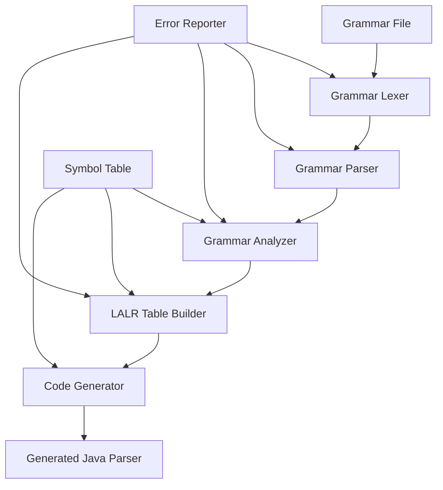

# Design Document

## Overview

The Yacc-like parser generator is designed as a multi-phase compiler tool that transforms grammar specifications into executable LALR(1) parsers. The system follows a pipeline architecture with distinct phases: lexical analysis of grammar files, syntax analysis, semantic analysis (grammar validation), LALR table construction, and Java code generation.

The architecture emphasizes separation of concerns through SOLID principles, with each major component isolated in its own class and file. The design supports extensibility for future enhancements like GLR parsing or different target languages.

## Architecture

The system follows a layered architecture with clear separation between phases:



### Core Components

1. **Grammar Processing Layer**: Handles input grammar parsing and validation
2. **Analysis Layer**: Performs grammar analysis and LALR construction
3. **Generation Layer**: Produces target language code
4. **Support Layer**: Provides utilities, error handling, and data structures

## Components and Interfaces

### Grammar Processing Components

#### GrammarLexer
- **Responsibility**: Tokenizes grammar input files
- **Interface**: `TokenStream tokenize(String grammarText)`
- **Key Methods**:
  - `nextToken()`: Returns next token from input
  - `peek()`: Looks ahead at next token without consuming
  - `getPosition()`: Returns current line/column position

#### GrammarParser
- **Responsibility**: Parses tokenized grammar into AST
- **Interface**: `Grammar parse(TokenStream tokens)`
- **Key Methods**:
  - `parseGrammar()`: Main parsing entry point
  - `parseProduction()`: Parses individual production rules
  - `parseTerminal()`: Parses terminal definitions

#### Grammar
- **Responsibility**: Represents parsed grammar structure
- **Key Properties**:
  - `startSymbol`: The grammar's start symbol
  - `productions`: List of production rules
  - `terminals`: Set of terminal symbols
  - `nonTerminals`: Set of non-terminal symbols

### Analysis Components

#### GrammarAnalyzer
- **Responsibility**: Validates grammar and computes analysis sets
- **Interface**: `AnalysisResult analyze(Grammar grammar)`
- **Key Methods**:
  - `computeFirstSets()`: Calculates FIRST sets for all symbols
  - `computeFollowSets()`: Calculates FOLLOW sets for non-terminals
  - `detectLeftRecursion()`: Identifies left-recursive productions
  - `validateGrammar()`: Performs comprehensive grammar validation

#### FirstFollowCalculator
- **Responsibility**: Computes FIRST and FOLLOW sets
- **Interface**: Provides utility methods for set computation
- **Key Methods**:
  - `first(Symbol symbol)`: Returns FIRST set for a symbol
  - `follow(NonTerminal nt)`: Returns FOLLOW set for non-terminal

### LALR Construction Components

#### LRItemSet
- **Responsibility**: Represents a set of LR(0) items
- **Key Properties**:
  - `items`: Collection of LR items
  - `id`: Unique identifier for the state
- **Key Methods**:
  - `closure()`: Computes closure of item set
  - `goto(Symbol symbol)`: Computes GOTO for a symbol

#### LALRTableBuilder
- **Responsibility**: Constructs LALR parsing tables
- **Interface**: `ParsingTable buildTable(Grammar grammar, AnalysisResult analysis)`
- **Key Methods**:
  - `buildLR0Automaton()`: Constructs LR(0) state machine
  - `mergeLALRStates()`: Merges compatible states for LALR
  - `buildActionTable()`: Creates ACTION table
  - `buildGotoTable()`: Creates GOTO table

#### ParsingTable
- **Responsibility**: Represents complete LALR parsing tables
- **Key Properties**:
  - `actionTable`: ACTION table for parser decisions
  - `gotoTable`: GOTO table for state transitions
  - `states`: Collection of parser states

### Code Generation Components

#### JavaCodeGenerator
- **Responsibility**: Generates Java parser implementation
- **Interface**: `GeneratedCode generate(Grammar grammar, ParsingTable table)`
- **Key Methods**:
  - `generateParserClass()`: Creates main parser class
  - `generateTokenClasses()`: Creates token type classes
  - `generateASTNodes()`: Creates AST node classes
  - `generateParsingTables()`: Embeds parsing tables in code

#### CodeTemplate
- **Responsibility**: Manages code generation templates
- **Interface**: Template-based code generation utilities
- **Key Methods**:
  - `fillTemplate(String template, Map<String, Object> data)`
  - `generateClassFile(String className, String content)`

### Support Components

#### Symbol
- **Responsibility**: Base class for grammar symbols
- **Subclasses**: `Terminal`, `NonTerminal`
- **Key Properties**:
  - `name`: Symbol name
  - `type`: Symbol type (terminal/non-terminal)

#### Production
- **Responsibility**: Represents a grammar production rule
- **Key Properties**:
  - `leftSide`: Left-hand side non-terminal
  - `rightSide`: Right-hand side symbol sequence
  - `id`: Unique production identifier

#### ErrorReporter
- **Responsibility**: Centralized error handling and reporting
- **Interface**: `void reportError(ErrorType type, String message, Position position)`
- **Key Methods**:
  - `reportSyntaxError()`: Reports grammar syntax errors
  - `reportSemanticError()`: Reports grammar semantic errors
  - `reportConflict()`: Reports parser conflicts

## Data Models

### Core Data Structures

#### Symbol Hierarchy
```java
abstract class Symbol {
    String name;
    SymbolType type;
}

class Terminal extends Symbol {
    String pattern;
    int precedence;
    Associativity associativity;
}

class NonTerminal extends Symbol {
    Set<Production> productions;
}
```

#### Grammar Representation
```java
class Grammar {
    NonTerminal startSymbol;
    Set<Production> productions;
    Set<Terminal> terminals;
    Set<NonTerminal> nonTerminals;
    Map<String, Symbol> symbolTable;
}
```

#### LALR State Machine
```java
class LALRState {
    int id;
    Set<LRItem> items;
    Map<Symbol, LALRState> transitions;
    Map<Terminal, Action> actions;
}

class LRItem {
    Production production;
    int dotPosition;
    Set<Terminal> lookaheads;
}
```

### Parsing Tables Structure
```java
class ParsingTable {
    Map<StateSymbolPair, Action> actionTable;
    Map<StateSymbolPair, Integer> gotoTable;
    List<LALRState> states;
}

enum ActionType { SHIFT, REDUCE, ACCEPT, ERROR }

class Action {
    ActionType type;
    int parameter; // state number for shift, production number for reduce
}
```

## Error Handling

### Error Categories
1. **Lexical Errors**: Invalid characters or malformed tokens in grammar
2. **Syntax Errors**: Grammar doesn't conform to expected format
3. **Semantic Errors**: Valid syntax but invalid grammar semantics
4. **LALR Conflicts**: Grammar not suitable for LALR parsing
5. **Generation Errors**: Issues during code generation phase

### Error Recovery Strategy
- **Panic Mode Recovery**: Skip tokens until synchronization point
- **Error Productions**: Special productions for common error patterns
- **Multiple Error Reporting**: Collect and report multiple errors when possible
- **Contextual Messages**: Provide specific guidance based on error type

### Conflict Resolution
- **Shift/Reduce Conflicts**: Report with suggested precedence rules
- **Reduce/Reduce Conflicts**: Report with grammar restructuring suggestions
- **Ambiguity Detection**: Identify and report ambiguous grammar constructs

## Testing Strategy

### Unit Testing Approach
1. **Component Isolation**: Test each class independently with mocks
2. **Grammar Fixtures**: Create test grammars for various scenarios
3. **Table Verification**: Validate LALR table construction correctness
4. **Code Generation Testing**: Verify generated code compiles and runs

### Integration Testing
1. **End-to-End Pipeline**: Test complete grammar-to-parser transformation
2. **Example Grammars**: Test with arithmetic, programming language grammars
3. **Error Scenarios**: Verify error handling across all components
4. **Performance Testing**: Ensure reasonable performance on large grammars

### Test Grammar Suite
- **Simple Grammars**: Basic expression grammars
- **Complex Grammars**: Programming language subsets
- **Problematic Grammars**: Left-recursive, ambiguous grammars
- **Edge Cases**: Empty productions, single-symbol grammars

The design ensures modularity, testability, and extensibility while maintaining clear separation of concerns throughout the parser generation pipeline.